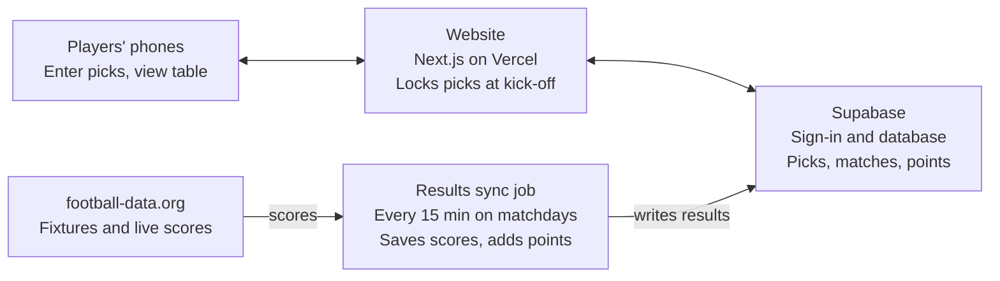

# Premier League Predictor — PRD

Nov 5, 2026 · Ben Farrell

> Exported from the live Claude Doc: https://claude.ai/artifact/N8JsXUezNFSHjF6WUVBNwd

## Overview

A simple website where Ben and a group of friends predict the score of each weekend's Premier League games and compete on a leaderboard that updates automatically from real results.

Today this kind of game usually runs on a group chat and a spreadsheet: someone collects predictions by hand, checks scores, and tallies points. The site removes that admin. Everyone enters predictions on their phone before kick-off, real scores are pulled in after full time, and points are calculated with no manual work.

- **Who it's for:** a private group of friends (roughly 5–30 people), not the public.
- **What it is not:** a betting product. No money changes hands on the site.

## Goals and non-goals

Version 1 succeeds if the group can play a full gameweek — predict, watch, and see the leaderboard update — without anyone doing admin.

**Goals (v1)**

1. Enter a score prediction for every match in a gameweek in under 2 minutes on a phone.
2. Lock predictions automatically at kick-off so no one can change a pick after a game starts.
3. Pull real Premier League results automatically and award 5 / 2 / 0 points.
4. Show a leaderboard for the season and for the current gameweek.
5. Look and feel like the Premier League (purple, pink, green, white).

**Non-goals (v1)**

- Betting, payments, or prize pots.
- Other competitions (FA Cup, Champions League, other leagues).
- Public sign-up or multiple separate groups — one private group only.
- Native iOS or Android apps; a mobile-friendly website is enough.
- Bonus mechanics such as jokers, double points, or first-goalscorer picks.

## Users and user stories

There are two roles: players, and one admin (Ben) who is also a player.

| Role | As a… I want to… | So that… |
| --- | --- | --- |
| Player | see this weekend's fixtures with kick-off times | I know what to predict and by when |
| Player | type a home and away score for each match and save | my picks are in before the deadline |
| Player | edit my picks until each game kicks off | I can react to team news |
| Player | see everyone's picks once a game has started | we can compare and banter |
| Player | see my points per match after full time | I understand how I scored |
| Player | see the season and gameweek leaderboard | I know where I stand |
| Admin | invite friends with a link or code | only our group can join |
| Admin | correct a result or postpone a match by hand | a bad data feed doesn't spoil the scores |
| Admin | remove a player | the group stays tidy |

## Scoring rules

Each match scores 5 points for the exact score, 2 points for the correct result (home win, draw, or away win), and 0 otherwise. Points do not stack: an exact score earns 5, not 7.

| Prediction | Actual result | Points | Why |
| --- | --- | --- | --- |
| 2-1 | 2-1 | 5 | Exact score |
| 2-1 | 3-1 | 2 | Correct result (home win), wrong score |
| 1-1 | 0-0 | 2 | Correct result (draw), wrong score |
| 0-2 | 1-3 | 2 | Correct result (away win), wrong score |
| 2-1 | 1-1 | 0 | Predicted home win, game was a draw |
| 1-0 | 0-1 | 0 | Predicted home win, away team won |

**Edge cases**

- **No prediction:** 0 points for that match.
- **Score used:** the result at full time (90 minutes plus stoppage time). Premier League games have no extra time or penalties.
- **Postponed or abandoned match:** no points until it is played; predictions carry over to the rescheduled date and stay editable until the new kick-off.
- **Result corrected later:** points recalculate automatically and the leaderboard updates.
- **Leaderboard ties:** split first by number of exact scores, then by number of correct results; if still level, players share the position.

## Functional requirements

Five screens cover v1: Join, Predictions, Results, Leaderboard, and Admin.

**1. Joining and signing in**

- Admin shares one private invite link; anyone with the link can join the group.
- Sign-in by email magic link or Google — no passwords to remember.
- Each player sets a display name shown on the leaderboard.

**2. Predictions**

- Default view is the next gameweek: all 10 fixtures with team badges, date and kick-off time (UK time).
- Two number boxes per match (home, away), whole numbers 0–9.
- One Save button for the whole gameweek; a clear "saved" confirmation.
- Each match locks at its own kick-off time. Locked matches show the pick read-only.
- A badge or count shows how many matches still need a pick.

**3. Results and points**

- After full time, each match shows the real score, the player's pick, and points earned (5 / 2 / 0).
- Once a match kicks off, everyone's picks for it become visible.

**4. Leaderboard**

- Season table: position, name, total points, exact scores, correct results.
- Gameweek tab: points for the selected gameweek only, with a gameweek picker.
- Updates within 15 minutes of a match ending.

**5. Results sync**

- Fixtures for the season are loaded from a football data API, including date changes.
- Scores are fetched on a schedule on matchdays and points are recalculated.
- Admin can override any score or mark a match postponed.

**6. Admin**

- View players, remove a player, regenerate the invite link.
- Edit a match result and trigger a recalculation.

## Design and theme

The site uses the Premier League's colour palette, is built phone-first, and keeps every main action one tap from the home screen.

| Colour | Approx. hex | Use |
| --- | --- | --- |
| Deep purple | #37003C | Header, nav bar, primary background |
| Magenta pink | #E90052 | Primary buttons, highlights |
| Neon green | #00FF85 | Exact-score (5 pt) badges, success states |
| Cyan | #04F5FF | Correct-result (2 pt) badges, links |
| White | #FFFFFF | Cards and text on purple |

Hex values are approximate, taken from memory of the league's branding.

**Principles**

- Bottom navigation with three tabs: Predict, Results, Table.
- Large tap targets for score entry; number keypad opens on phones.
- Club badges beside team names so fixtures are quick to scan.
- Clear deadline countdown on the Predict screen.
- Use the colour palette only — not the official Premier League logo or name as branding, which are trademarks. Give the site its own name (open question below).

## Data and technical approach

Recommended: a Next.js website on Vercel, with Supabase for sign-in and the database, and football-data.org for fixtures and live scores — all on free tiers for a group this size.

Players only touch the website; a scheduled job pulls scores from the data provider and writes results and points into the database.

**Score data source options** (from memory; check current terms before building)

| Provider | Free tier | Notes |
| --- | --- | --- |
| football-data.org | Premier League included; about 10 requests/minute | Simple API, good fit for v1 |
| API-Football (api-sports.io) | About 100 requests/day | More detail (lineups, events); tighter daily cap |

**Data model**

| Table | Key fields |
| --- | --- |
| players | id, display name, email, is admin |
| gameweeks | number (1–38), season, first kick-off |
| matches | id, gameweek, home team, away team, kick-off, status, home goals, away goals |
| predictions | player, match, home goals, away goals, points, updated at |

Points are stored on each prediction when a match finishes, so the leaderboard is a simple sum and recalculates if a result is corrected.

## Success, milestones, risks and open questions

**Success measures**

- Every invited friend joins and submits picks in the first gameweek.
- At least 80% of players submit picks for each gameweek.
- Zero manual score entry by the admin in a normal gameweek.
- Leaderboard correct within 15 minutes of the last match ending.

**Milestones**

1. Clickable mock-up of the Predict, Results and Table screens in the Premier League colours.
2. Sign-in, invite link, and prediction entry with kick-off locking.
3. Fixture and score sync from the data API, with automatic points.
4. Leaderboard (season and gameweek) and admin tools.
5. Test with 2–3 friends for one gameweek, then open to the whole group.

**Risks**

| Risk | Impact | Mitigation |
| --- | --- | --- |
| Score API is late, wrong, or changes its free tier | Points delayed or wrong | Admin override; second provider as fallback |
| Players forget to predict | Low engagement | Deadline countdown; optional reminder email before the first kick-off |
| Kick-off times move for TV | Picks lock at the wrong time | Re-sync fixtures daily |
| Use of league branding | Trademark complaint | Colours only, own site name, no official logo |

**Open questions**

- [ ] What is the site called?
- [ ] Roughly how many friends will play?
- [ ] Start mid-season now, or wait for the 2027/28 season?
- [ ] Should reminders go by email, WhatsApp, or not at all?
- [ ] Show other players' picks before kick-off, or only after?
